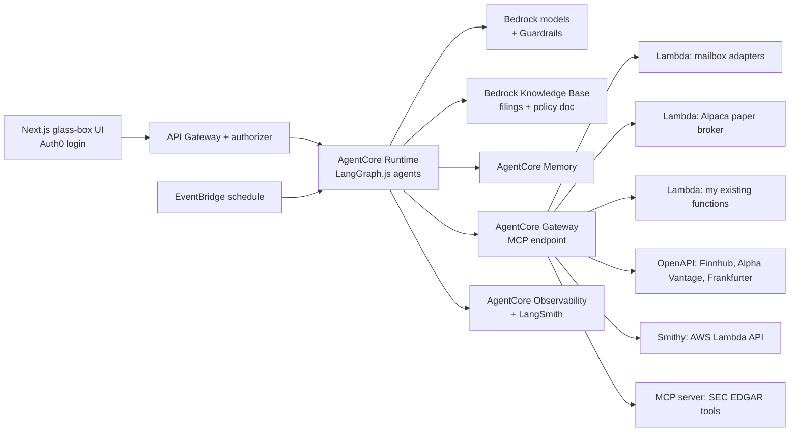

# Personal CFO

A proactive AI finance assistant that reads your inbox and the market news, and runs an **investment committee** of AI agents. The agents argue about a stock, check the idea against your rules, and propose **paper** trades for you to approve.

> **Status:** design phase. See [PLANNING.md](PLANNING.md) for the step-by-step build plan.
>
> **Sandbox only:** fake mailbox, paper trading account, test data. This is a learning project, not financial advice.

## Why this project

I built Personal CFO to learn how to build AI agents on AWS properly. That means more than one chatbot: multiple agents, real tools, memory, retrieval, guardrails, evaluation and observability, all in one product I can demo.

## What it does

| Agent | Job |
|---|---|
| **Inbox agent** | Reads a mailbox (fake today; Gmail, Outlook or IMAP later). Sorts emails, pulls out bills, broker statements and dividend notices, flags scams and phishing, and turns stock mentions into signals. |
| **News agent** | Follows market news and SEC filings for your watchlist and portfolio, ranks stories by how much they matter to *you*, and emits signals such as earnings surprises or downgrades. |
| **Investment committee** | A multi-agent debate on one ticker: **Analyst** gathers facts, **Bull** and **Bear** argue in parallel, **Risk manager** checks the idea against your Investment Policy Statement, and **Chair** writes a memo with a verdict and citations. |
| **Ops agent** | Inspects, invokes and proposes config changes to your tagged Lambda functions through AgentCore Gateway. Every change needs your approval. |
| **Morning briefing** | A scheduled digest combining inbox, news and committee memos. |

Any trade the committee proposes goes to an **Alpaca paper trading** account, and only after you click **Approve**. Every memo is saved, so the committee builds a **track record** you can check later.

## Architecture

## Key design ideas

- **Swappable mailbox.** One `MailProvider` interface with fake, Gmail, Outlook and IMAP adapters, checked by shared contract tests. Switching providers is a config change.
- **Gateway as the tool backbone.** Every tool goes through AgentCore Gateway, using all four target types: Lambda, OpenAPI, Smithy and MCP server.
- **Human in the loop.** Paper trades and Lambda changes pause the LangGraph run (`interrupt()`) until a human approves.
- **Untrusted input everywhere.** Emails, news and filings can carry prompt injections. Tools are read-only by default, and permissions come from verified token claims, never from chat text.
- **Numbers come from tools.** Calculations happen in tools or Code Interpreter, never in the model's head, and guardrail grounding checks enforce this.
- **Evals from day one.** The seeded mailbox and the red-team sets have known answers, so quality is measured, not guessed.

## Tech stack

| Area | Choice |
|---|---|
| Language | TypeScript (monorepo) |
| Agents | LangChain.js, LangGraph.js |
| Models | Amazon Bedrock (Converse API) |
| Agent platform | Bedrock AgentCore: Runtime, Gateway, Identity, Memory, Observability, Code Interpreter |
| Safety | Bedrock Guardrails |
| Retrieval | Bedrock Knowledge Base (vector store to be decided) |
| Data | DynamoDB, S3 |
| External APIs | Alpaca (paper), Finnhub, Alpha Vantage, SEC EDGAR, Frankfurter |
| UI | Next.js on S3 and CloudFront |
| Auth | Auth0 |
| Infrastructure | AWS CDK (TypeScript) |
| Evals and tracing | LangSmith, AgentCore Observability |

## What I'm learning

- **Agents:** tool calling, structured output, multi-agent debate, supervisor routing, human-in-the-loop
- **LangGraph:** state graphs, parallel branches, subgraphs, checkpointers, streaming
- **Bedrock:** Converse API, Guardrails, Knowledge Bases and vector stores
- **AgentCore:** Runtime, Gateway (every target type, inbound and outbound auth, tool search), Identity, Memory, Observability
- **MCP:** consuming tools through Gateway, building and hosting my own MCP server
- **AI security:** prompt injection, least-privilege IAM, approval gates
- **Evals:** golden datasets, LLM-as-judge, red-team sets, evals in CI
- **Architecture:** ports and adapters, contract tests, infrastructure as code

## Roadmap

| # | Milestone | Demo |
|---|---|---|
| 1 | Foundations | Local LangGraph agent answers using a fake-mailbox tool |
| 2 | Inbox agent | Mailbox triaged, with an eval report |
| 3 | News agent | Ranked news signals for a watchlist |
| 4 | Investment committee | Bull/Bear debate and a cited memo |
| 5 | Paper trading and guardrails | Approve a paper trade; injection attempts blocked |
| 6 | AgentCore deploy and Gateway | Agents in the cloud, tools over MCP, traces |
| 7 | Web UI and auth | Glass-box chat with approval cards |
| 8 | Memory, briefing and track record | Personal morning briefing |
| 9 | MCP server, Ops agent and CI evals | Tools in Claude Desktop; approved Lambda change |

Details for each milestone are in [PLANNING.md](PLANNING.md).

## Author

Built by Majid as part of a series of AI and AWS learning projects. More at [majidln.com](https://majidln.com).
